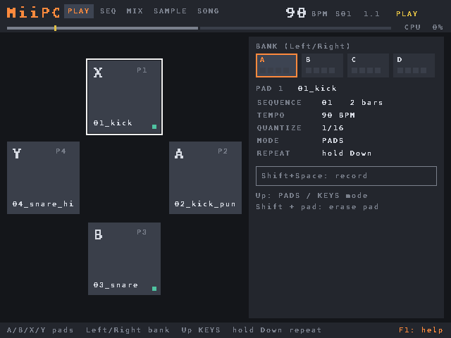
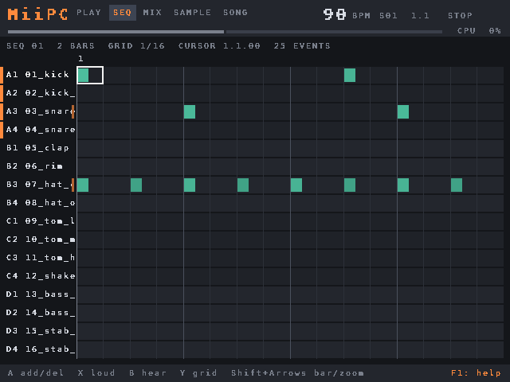
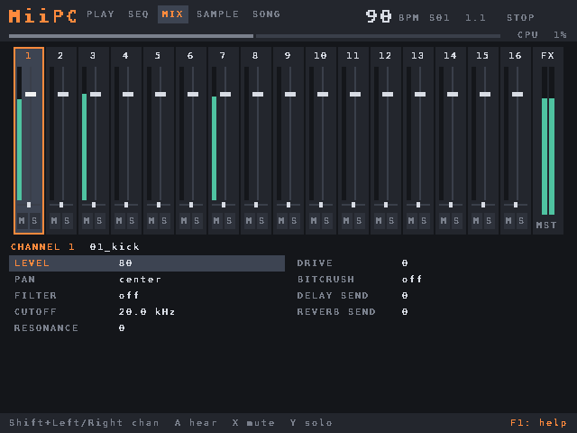
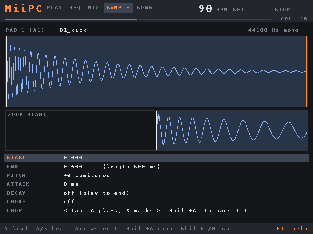
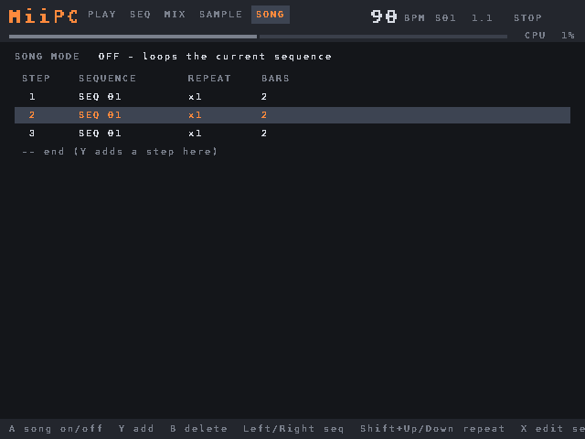

# MiiPC

A sample-based groovebox for **Miyoo Mini / Mini Plus / Mini v4** on **Onion OS**, inspired by the
workflow of classic pad samplers: pads, chopping, a linear sequencer, a mixer and effects.
All design, sound and graphics are original.







## Features (v0.4)

- Runs on every Miyoo Mini model: v1-v3 and Mini Plus (640x480), Mini v4 (752x560, auto-detected)
- **Play:** 4 pads on A/B/X/Y (laid out like the buttons), 4 banks on Left/Right = 16 pads,
  note repeat (hold Down), KEYS mode (one pad played chromatically)
- **Linear sequencer:** 16 sequences, 1-32 bars each, 96 PPQ resolution, live recording with
  count-in and quantize (off, 1/8, 1/8T, 1/16, 1/16T, 1/32), swing, metronome
- **Song mode:** chain sequences with repeats
- **Grid editor:** events at their exact tick, add/delete/velocity, adjustable grid and zoom
- **Mixer:** level, pan, mute/solo, meters, per-channel filter (LP/HP/BP + resonance), drive,
  bitcrush, delay and reverb sends
- **Master FX:** tempo-synced ping-pong delay, reverb, compressor, soft limiter
- **Sample editing:** waveform with zoom, start/end, pitch, attack/decay, choke groups,
  optional snap to zero crossings
- **Chop:** tap slicing while it plays, equal slices or transient detection, laid out on pads
- **Resample / export:** render a sequence to a new pad or to a WAV file
- **Undo / redo** (12 steps), tap tempo, CPU and battery in the header
- **File browser:** browse the whole SD card and audition WAVs before loading
- **Projects:** save / save as / open / new, autosave every 2 minutes and on quit

## Quick start on a Linux PC

From this folder, with nothing to install:

```sh
sh start-linux.sh                     # or double-click start-linux.sh > Run
MIIPC_RES=752x560 sh start-linux.sh   # Mini v4 screen layout
```

It runs the ready-built `bin/miipc-linux-x86_64` (refresh it with `make linux-bin`).
Projects, exports and resampled sounds are saved in this folder.

## Controls

SELECT and START only open the settings page and the project menu. R2 is a SHIFT key.

| Miyoo | PC key | |
|---|---|---|
| D-pad | Arrow keys | |
| A / B / X / Y | A / B / X / Y | Pads, edit actions |
| L1 / R1 | Q / W | Previous / next view (SHIFT: undo / redo) |
| L2 | Space (or 1) | Play / stop (SHIFT: record) |
| R2 | Shift (or 2) | SHIFT, hold together with another button |
| SELECT | Tab | Settings |
| START / MENU | Enter / Esc | Project menu |
| | F1 | Help screen |

A help screen opens on first start (F1 on PC, MENU > Help on the Miyoo), and the line at the bottom
of the screen shows the keys for the current view, with keyboard names on PC and button names on
the Miyoo.
Details per view: [`package/linux/README.txt`](package/linux/README.txt).

## Building

PC (for quick development, uses the system SDL2):

```sh
sudo apt install libsdl2-dev
make run                         # MIIPC_RES=752x560 make run for the Mini v4 layout
make PLATFORM=desktop12          # SDL 1.2 build = same code path as the Miyoo
```

Portable Linux test package (zig cc targeting glibc 2.17 + static SDL2, so it runs on
Linux Mint 19+ and other distros without installing anything):

```sh
tools/build-linux-release.sh     # dist/miipc-linux-x86_64.tar.gz
```

Miyoo Mini (ARMv7 Cortex-A7, hard-float), via Docker and the Union toolchain:

```sh
tools/docker-build.sh            # creates dist/MiiPC/
```

Copy `dist/MiiPC/` to `/mnt/SDCARD/App/MiiPC/` on the SD card. The app shows up under Apps in Onion.

## Architecture

```
src/
  main.c         Main loop, header/footer, project menu, browser glue
  view_play.c    Play view (A/B/X/Y pads, banks, sequence settings)
  view_seq.c     Grid editor for the linear sequencer
  view_mix.c     Mixer strips, channel inserts, FX/master
  view_sample.c  Waveform, region, voice parameters, chop
  engine.c       Sample pool, voices, sequencer and mixing in the audio callback
  fx.c           SVF filter, drive, bitcrush, delay, reverb, compressor
  sample.c       WAV reader, waveform cache, transient detection
  project.c      .mpj project files (text, key=value)
  browser.c      File browser
  help.c         Help screen, key names per platform
  gfx.c          Drawing, resolution detection, 8x12 bitmap font
package/MiiPC/   Onion app: config.json, launch.sh, icon.png
package/linux/   PC test package (start.sh, README.txt)
tools/           Font and sound generators, Miyoo Docker build, portable Linux build
```

Design notes:

- **C99 + SDL 1.2 on the Miyoo, SDL2 on PC.** Onion ships SDL 1.2 with a Miyoo video driver and
  audio, so the device build needs no extra libraries. The PC build uses SDL2 (scaled, resizable
  window); the few differences live in `gfx.c` and the key handling in `main.c`.
- **Everything audio happens in the callback.** Sequencer events, mixing and effects run per sample
  frame, so timing is sample-accurate. A desktop benchmark with 16 voices, every insert and every
  master effect active uses about 1.7% of one x86 core; the Cortex-A7 is expected to need roughly
  10x that, which leaves plenty of headroom (to be measured on device).
- **Linear sequencer.** Events are stored as (tick, pad, velocity) at 96 PPQ. Swing warps playback
  time inside each 8th note instead of moving events, so the event order never changes.
- **Pads share the sample pool.** Several pads can point at the same file with their own region
  (chops) without copying audio. Unused files are freed automatically.
- **512-frame buffer @ 44.1 kHz** (~12 ms) for playable latency.

## Roadmap

1. **Test on device:** latency, CPU, button mapping and the v4 resolution on real hardware
2. Song mode (chain sequences), note repeat, copy/paste bars
3. Naming projects with an on-screen keyboard, snap chops to zero crossings
4. Resampling (bounce to a new sample), export to WAV
